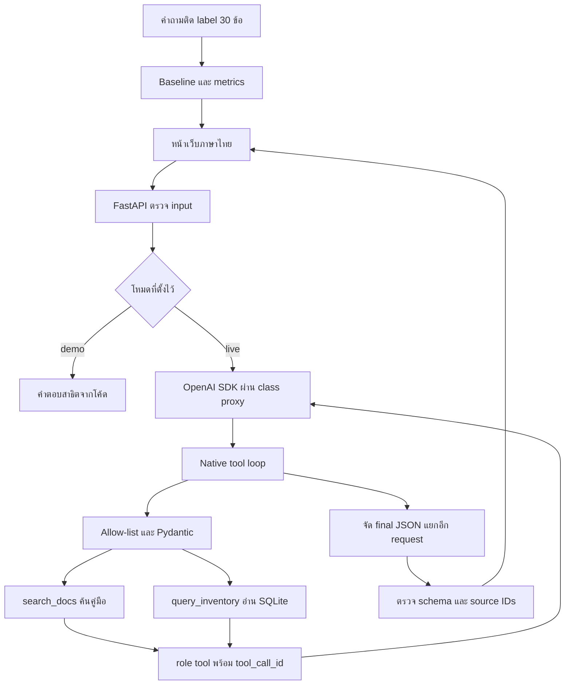

# GearMate — ผู้ช่วยยืมอุปกรณ์ชมรม

แอปภาษาไทยสำหรับค้นกฎการยืมอุปกรณ์และตรวจรายการว่างจาก SQLite โดย agent เลือก tool เอง พร้อมแสดงแหล่งอ้างอิงและผลการเรียก tool ให้ตรวจสอบ

**สถานะปัจจุบัน:** เชื่อม class proxy ด้วย `gemma-4-E4B-it` และทดสอบจริง มีผล smoke test 3 สถานการณ์ใน [`results/live-smoke.json`](results/live-smoke.json) ส่วน retrieval evaluation 30 ข้อเป็นการวัดอีกชุดหนึ่ง ไม่ใช่คะแนนความถูกต้องของคำตอบ LLM

**เว็บlink:** [GearMate](https://gearmate.onrender.com)

[](https://render.com/deploy?repo=https://github.com/Chayapon8251/llm_lastwork)


## แอปช่วยอะไร

คำถามอย่าง **“กล้องว่างกี่ตัว และต้องวางเงินประกันมั้ย กี่บาท?”** ต้องใช้ทั้งจำนวนจากตารางและเงื่อนไขในคู่มือ GearMate จึงมีสอง tool:

- `search_docs`: ค้นนโยบายการยืม พร้อมข้อความและ source ID
- `query_inventory`: อ่าน SQL snapshot ด้วยตัวกรองที่ตรวจสอบแล้ว ไม่รับ raw SQL จากโมเดล

ข้อมูลทั้งหมดเป็นชมรมสมมติที่สร้างใหม่สำหรับโครงงาน: 18 นโยบายไทย/อังกฤษและอุปกรณ์ 12 ชิ้น ไม่ใช่ข้อมูลมหาวิทยาลัยจริง ไม่ใช้ corpus ของแอปตัวอย่าง และไม่มีการจอง ชำระเงิน หรือลบข้อมูลจริง

## สิ่งที่ทดสอบกับโมเดลจริงแล้ว

| คำถาม | สิ่งที่ตรวจพบ |
|---|---|
| สวัสดีครับ | โมเดลตอบโดยไม่เรียก tool |
| กล้องว่างกี่ตัว และเงินประกันเท่าไร | ใช้ SQL และค้นคู่มือ ตอบ 2 กล้อง ประกัน 300 บาทต่อรายการ อ้าง inventory และ camera_deposit |
| มีโดรนให้ยืมไหม | โมเดลขอ category=drone ซึ่ง validator ปฏิเสธ แล้วตอบว่าไม่มีข้อมูลในหมวดที่รองรับ |

กรณีโดรนแสดงการป้องกัน arguments นอก schema ไม่ใช่การค้นแล้วพบว่าจำนวนโดรนเป็นศูนย์ ผลทั้งสามเป็น smoke test ของการเชื่อมต่อและเส้นทาง tool ยังไม่พออ้าง accuracy หรือ faithfulness โดยรวม

## รันบนเครื่อง

ใช้ Python 3.11 ขึ้นไป เครื่องที่ทดสอบใช้ Python 3.12

```powershell
git clone https://github.com/Chayapon8251/llm_lastwork.git
cd llm_lastwork
py -m venv .venv
.\.venv\Scripts\python.exe -m pip install -r requirements.lock.txt
.\.venv\Scripts\python.exe -m scripts.evaluate
.\.venv\Scripts\python.exe -m uvicorn app.main:app --host 127.0.0.1 --port 8000
```

เปิด http://127.0.0.1:8000 และดู REST API schema ที่ http://127.0.0.1:8000/docs หากเคยติดตั้งแล้วใช้ `run.ps1` ได้ ส่วน Linux/macOS ใช้ `python3 -m venv .venv` และ `.venv/bin/python` แทน path ของ Python

### ตั้งค่า class proxy

คัดลอก `.env.example` เป็น `.env` เฉพาะเมื่อยังไม่มีไฟล์ `.env` แล้วตั้งค่าจากผู้สอน:

```dotenv
OPENAI_API_KEY=your-class-proxy-key
OPENAI_BASE_URL=https://llm.nat-d.uk/v1
OPENAI_MODEL=gemma-4-E4B-it
GEARMATE_MODE=live
```

SDK ใช้ `from openai import OpenAI; OpenAI()` อ่านค่าจาก environment และคงโมเดลตามโจทย์ **อย่าส่ง `.env` หรือ API key ขึ้น Git** browser ไม่มี endpoint อ่าน key เริ่ม server ใหม่หลังแก้ `.env`

- `auto`: ใช้ live เมื่อมีทั้ง key และ base URL มิฉะนั้นเป็นโหมดสาธิตที่ติดป้ายชัดเจน
- `live`: ต้องมีค่าครบ ถ้า proxy ล้มเหลวให้ error ไม่สลับไปตอบจากโค้ดเงียบ ๆ
- `demo`: การเลือก tool และคำตอบมาจากโค้ด ไม่ใช่ LLM
- ป้าย configured หมายถึงมีค่าครบ ไม่ใช่การตรวจ key กับ proxy ต้องลองคำถามหรือรัน `python -m scripts.smoke_live`

## Deploy แอปเดิมบน Render

ใช้ Python/FastAPI เดิมทั้ง frontend และ backend ใน Web Service เดียว ไม่ใช่การอัปโหลด HTML อย่างเดียว และไม่ต้องเปิดเครื่องส่วนตัวทิ้งไว้

1. เปิดปุ่ม Deploy to Render ด้านบน หรือสร้าง Blueprint จาก repo นี้
2. ตรวจว่าใช้ Free instance ตาม `render.yaml` โดยไม่มีฐานข้อมูลแบบเสียเงินเพิ่ม
3. ใส่ `OPENAI_API_KEY` เฉพาะใน environment ของ Render ช่องนี้ตั้งเป็น `sync: false` จึงไม่อยู่ใน YAML หรือ Git
4. รอ build และ health check `/healthz` ผ่าน แล้วทดสอบคำถามจริงบน URL `.onrender.com` ที่ Render ให้
5. เมื่อยืนยันแล้ว ใส่ URL นั้นในส่วนเว็บออนไลน์ของ README และใช้ส่ง Q3 ได้

Free service อาจพักเมื่อไม่มี request ประมาณ 15 นาที และการเปิดครั้งถัดไปอาจรอประมาณหนึ่งนาที ข้อมูลของเราโหลดจาก JSON ที่ commit ไว้และสร้าง SQLite snapshot ใหม่ได้ จึงไม่ต้องใช้ persistent disk

การ deploy เปิด `GEARMATE_PUBLIC_DEMO=true`: จำกัด `/api/chat` ที่ 6 requests/นาทีต่อ client, 40 requests/ชั่วโมงรวม และ 120 requests/วันรวม พร้อมขีดจำกัดขนาด body 64 KiB และ 2 requests ที่ประมวลผลพร้อมกัน Budget อยู่ในหน่วยความจำของ process เดียวและ reset เมื่อ restart ไม่ใช่ระบบ quota ถาวรสำหรับ production แต่ละคำถามยังเรียก LLM ได้หลายครั้งตาม agent loop

ทดสอบเว็บออนไลน์กับ class proxy จริงแล้วเมื่อ 27 ตุลาคม 2569: คำถามเรื่องกล้องเรียกทั้ง `query_inventory` และ `search_docs` ตอบ 2 กล้องและเงินประกัน 300 บาทต่อรายการ พร้อมแหล่งอ้างอิง ดูผลใน [`results/deployment-smoke.json`](results/deployment-smoke.json) และขั้นตอน deploy ใน [`docs/deploy-th.md`](docs/deploy-th.md)

## สถาปัตยกรรม



หยุดเมื่อโมเดลตอบโดยไม่มี tool call หรือครบ 5 model turns / 8 tool calls ปฏิเสธ call เดิมซ้ำ และส่งผลตอบทุก `tool_call_id` รวมกรณี parallel calls

| กลุ่มความสามารถในวิชา | ส่วนที่ใช้ |
|---|---|
| Structured output และ validation | `app/schemas.py` กับ final JSON renderer |
| Evaluation ที่โจทย์บังคับ | ชุด 30 ข้อและ `scripts/evaluate.py` |
| Agent loop แบบ agentic | native function calling พร้อม stop condition |
| SQL แบบ advanced/agentic | SELECT จาก template และ bound values บน query-only connection |
| REST และ UI | FastAPI พร้อมหน้าแชต คลังอุปกรณ์ และผลประเมิน |
| Retrieval และ citation | TF-IDF แบบ lexical ไม่ใช่ neural semantic embeddings |

## ประเมิน retrieval

```powershell
.\.venv\Scripts\python.exe -m scripts.evaluate
.\.venv\Scripts\python.exe -m pytest -q
```

| วิธี | k | Recall@k | Precision@k | MRR ในรายการที่คืน | ครบทุกแหล่ง |
|---|---:|---:|---:|---:|---:|
| Vector top-1 baseline | 1 | 0.8000 | 1.0000 | 1.0000 | 0.6000 |
| Vector top-3 เลือกใช้ | 3 | 0.9833 | 0.4556 | 1.0000 | 0.9667 |
| BM25 top-3 | 3 | 0.9667 | 0.4444 | 0.9833 | 0.9333 |
| Hybrid RRF top-3 | 3 | 0.9833 | 0.4556 | 1.0000 | 0.9667 |

เลือก vector top-3 เพราะ recall เพิ่มจาก top-1 ประมาณ 18.33 percentage points แต่การเปรียบเทียบนี้เปลี่ยนจำนวน context ด้วย ต้องไม่อ้างว่าผลดีขึ้นทั้งหมดมาจาก hybrid เมื่อเทียบที่ k=3 เท่ากัน hybrid เสมอกับ vector จึงยังไม่เลือกเป็น default

ชุดคำถามมี 18 single-source และ 12 multi-source สร้างควบคู่กับ corpus โดยใช้ AI ช่วย ยังไม่มี independent labels และมีความเสี่ยงจากคำที่ตรงกันมากเกินไป ผลนี้เป็น retrieval metrics ไม่ใช่คะแนนคำตอบ LLM ผลรายข้อและ hashes อยู่ใน `results/retrieval.json`

Failure ที่เก็บไว้: t27 ค้นเรื่องอบรมได้ แต่หลุดเงินประกันกล้องไปเป็นเงินประกันประเภทอื่น อีกคำถามนอกชุดคือ “ยืมได้กี่วัน” ซึ่ง retriever ตรง ๆ อาจไม่คืน duration ใน top-3 ถึงแม้การถามเจาะจงว่า “ระยะเวลายืมปกติ” จะค้นเจอ

## เอกสารและการส่งงาน

- **ฉบับหลักภาษาไทย แก้ไขต่อได้:** [`docs/report-th.docx`](docs/report-th.docx)
- **ข้อความสำหรับคัดลอกไป Google Docs:** [`docs/report-th.md`](docs/report-th.md)
- **PDF ภาษาอังกฤษฉบับเดิม:** [`docs/report.pdf`](docs/report.pdf) เป็นร่างก่อนยืนยัน proxy จริง ใช้อ่านประกอบ ไม่ใช่สถานะล่าสุด
- คู่มืออธิบายโค้ด [`docs/walkthrough-th.md`](docs/walkthrough-th.md)
- Proposal [`docs/proposal.md`](docs/proposal.md)
- บทเดโมทางเลือก [`docs/demo-script-th.md`](docs/demo-script-th.md)
- สถานะก่อนส่ง [`docs/submission-checklist.md`](docs/submission-checklist.md)

โจทย์ระบุว่าใช้ **“AI tools freely”** ได้ แต่ต้องมีข้อมูลและชุดประเมินของตนเอง และอธิบาย design choice กับตัวเลขได้ รายงานนี้ระบุการใช้ AI ตามจริง ผู้ส่งควรตรวจ labels และปรับคำอธิบายให้ตรงความเข้าใจ ไม่เปลี่ยนผลทดลองให้ดูดีกว่าที่รันได้

Q1 ส่ง public GitHub repo, Q2 ส่งรายงาน PDF 4–8 หน้าโดย export จากฉบับที่ตรวจแล้ว, Q3 เลือก **เว็บที่ deploy และทำงานจริง หรือคลิป 3–6 นาที** อย่างใดอย่างหนึ่ง ยังต้องเตรียมอธิบายกรณีสำเร็จและข้อจำกัดสำหรับการ demo กับผู้สอน

## แหล่งอ้างอิง

- Lectures 8–14 ของรายวิชา สำหรับ metrics, RRF, tool round-trip และ SQL guardrails
- [OpenAI function calling](https://developers.openai.com/api/docs/guides/function-calling)
- [Render FastAPI deployment](https://render.com/docs/deploy-fastapi) และ [ข้อจำกัด Free service](https://render.com/docs/free)

โค้ดและ corpus สร้างใหม่ด้วย AI assistance ไม่ได้ fork หรือเปลี่ยนหน้าตา reference app มาเป็นงานของตนเอง
