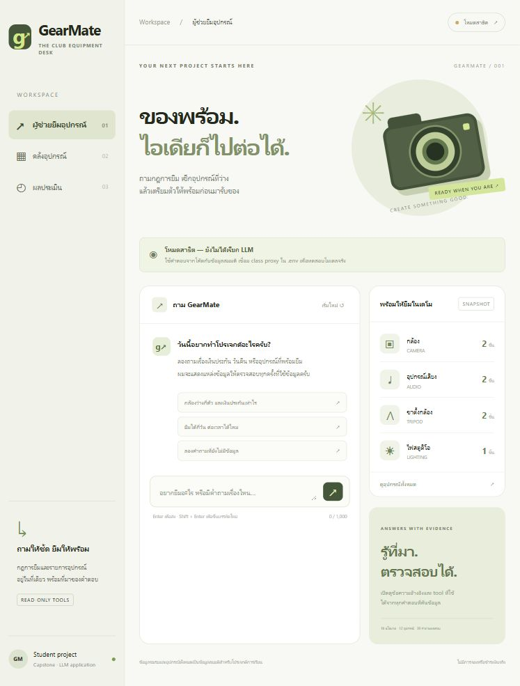
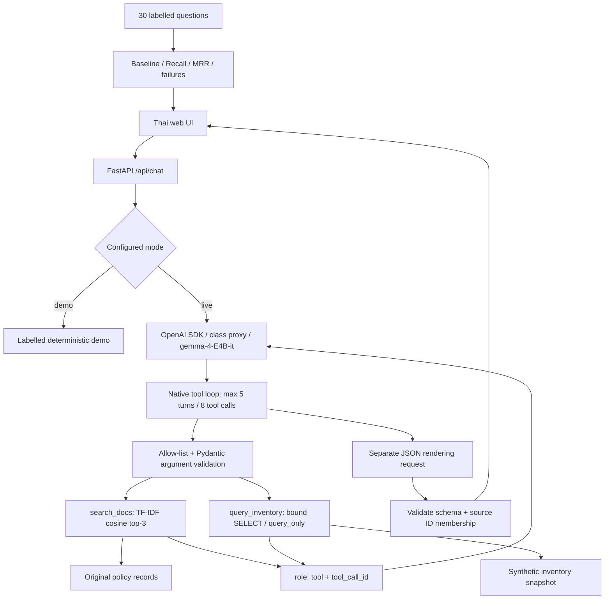

# GearMate — ถามก่อนยืม

ผู้ช่วยค้นกฎการยืมอุปกรณ์ชมรมและตรวจอุปกรณ์ว่างจาก SQLite พร้อมแหล่งอ้างอิง ผล tool และหน้าประเมิน retrieval

**สถานะ:** แอปรันได้และทดสอบ offline แล้ว ส่วน class proxy ยังต้องใส่ credentials และรัน smoke test จริงก่อนส่งงาน โหมด demo ใช้คำตอบจากโค้ดและติดป้ายชัดเจน ไม่ได้เรียก LLM



## ปัญหาและขอบเขต

นักศึกษาต้องค้นหลายที่เพื่อรู้ว่ายืมกล้องได้กี่วัน วางเงินประกันเท่าไร และเหลืออุปกรณ์กี่ชิ้น GearMate รวมข้อมูลเหล่านี้ในแชตเดียว โดย agent เลือก `search_docs` หรือ `query_inventory` และอธิบายคำตอบจากผลที่ได้รับ

ข้อมูลสมมติทั้งหมดสร้างสำหรับโปรเจกต์นี้: 18 นโยบายไทย/อังกฤษ และอุปกรณ์ 12 ชิ้น ไม่ใช้ corpus ของแอปตัวอย่างวิชา ไม่มีการจอง ตัดเงิน หรือแก้ไขรายการยืมจริง โดเมนสมมติไม่ใช่นโยบายมหาวิทยาลัยใด

## เริ่มรันบน Windows

ใช้ Python 3.11 ขึ้นไป (เครื่องที่พัฒนาและทดสอบใช้ Python 3.12)

```powershell
git clone https://github.com/Chayapon8251/llm_lastwork.git
cd llm_lastwork
py -m venv .venv
.\.venv\Scripts\python.exe -m pip install -r requirements.lock.txt
.\.venv\Scripts\python.exe -m scripts.evaluate
.\.venv\Scripts\python.exe -m uvicorn app.main:app --host 127.0.0.1 --port 8000
```

เปิด http://127.0.0.1:8000 และดู API schema ได้ที่ http://127.0.0.1:8000/docs ถ้ามี dependencies อยู่แล้ว ใช้ `powershell -ExecutionPolicy Bypass -File .\run.ps1` เพื่อรันใน process นี้ได้ ไม่ต้องเปลี่ยน execution policy ของระบบ

Linux/macOS: ใช้ `python3 -m venv .venv` และ `.venv/bin/python` แทน path ของ Python ด้านบน

### เชื่อม class proxy จริง

```powershell
Copy-Item .env.example .env
notepad .env
```

ใส่ค่าที่ได้จากผู้สอนใน `.env` ของเครื่อง:

```dotenv
OPENAI_API_KEY=your-class-proxy-key
OPENAI_BASE_URL=https://your-class-proxy.example/v1
OPENAI_MODEL=gemma-4-E4B-it
GEARMATE_MODE=live
```

URL ด้านบนเป็น placeholder ต้องใช้ URL จริงจากผู้สอน **ไม่ต้องส่ง key ลง GitHub หรือแชต** เริ่ม server ใหม่ แล้วป้ายจะเป็น Class proxy เมื่อข้อมูลครบ SDK ใช้ `from openai import OpenAI; OpenAI()` ซึ่งอ่าน environment ดังกล่าว โมเดลคงเป็น `gemma-4-E4B-it` ตามโจทย์

- `GEARMATE_MODE=auto`: ใช้ proxy เมื่อมีทั้ง key และ base URL มิฉะนั้นเป็น demo
- `GEARMATE_MODE=live`: ขาดค่าจะตอบ error ชัดเจน ไม่สลับไปจำลองเมื่อ proxy ล้มเหลว
- การแสดงว่า configured หมายถึงมีค่าครบ **ไม่ได้ยืนยันว่า key ใช้ได้** ต้องรัน `python -m scripts.smoke_live` เพื่อทดสอบจริง
- `.env` ถูก ignore; browser ไม่มี endpoint อ่าน key

## คำถามสำหรับลอง

1. `กล้องว่างกี่ตัว และต้องวางเงินประกันเท่าไร` → อ่าน SQL snapshot + ค้นนโยบาย
2. `ระยะเวลายืมปกติกี่วัน` → ค้นเอกสาร
3. `สวัสดีครับ` → ตอบโดยไม่ใช้ tool
4. `มีโดรนให้ยืมไหม` → ข้อมูลโดรนไม่มี ควรแจ้งข้อจำกัด
5. `ยืมได้กี่วัน` → failure ของ lexical retriever: คำสั้นอาจค้นเรื่องต่อเวลาแทนระยะเวลาปกติ อย่าตัดกรณีนี้ออกจากเดโม

ใน demo การเลือก tool เป็นกฎในโค้ดและการตอบเป็น extractive ไม่ใช่ความสามารถของ LLM; ใน live โมเดลเป็นผู้เลือก native tool calls และทำคำตอบขั้นสุดท้าย

## สถาปัตยกรรมและเทคนิคในวิชา



| Capability family | อยู่ตรงไหน | ข้อจำกัดที่ต้องบอก |
|---|---|---|
| Structured output + validation | `app/schemas.py`, final JSON renderer | schema ไม่พิสูจน์ว่าข้อความเป็นจริง |
| Evaluation (required) | `eval/test.json`, `scripts/evaluate.py` | ยังเป็น curated set ที่สร้างด้วย AI ช่วย |
| Agent loop (agentic) | `app/agent.py` native tool calling + stop/caps | ทดสอบ protocol ด้วย stubs แล้ว; real proxy ต้องทดสอบเพิ่ม |
| SQL (advanced/agentic) | `app/inventory.py` | model เลือกตัวกรอง; ไม่ได้สร้าง raw SQL อิสระ |
| Served interface | `app/main.py`, `static/` | local app; ยังไม่ได้ deploy |
| Retrieval + citations | `app/retrieval.py` | ใช้ sparse lexical TF-IDF vectors ไม่ใช่ neural semantic embeddings |

การตรวจ family ที่ชัดเจนใช้ structured output, evaluation, agent loop, SQL และ REST/UI ไม่ต้องอ้างว่าได้ทำ neural RAG หรือใช้ทุกเทคนิคในวิชา

### Retrieval choice

แต่ละนโยบายเป็น topic-sized chunk เพื่อเก็บเงื่อนไขครบ TF-IDF ใช้ character trigrams จึงไม่ต้องติดตั้ง Thai tokenizer; BM25 ใช้ English tokens + Thai bigrams RRF รวมด้วย rank ที่ k=60 มี threshold cosine 0.04 ซึ่งเป็นค่า heuristic จากการพัฒนา ไม่ใช่ calibrated confidence

**เลือก vector top-3 เป็น default** เพราะเทียบกับ top-1 แล้ว recall เพิ่ม ส่วน hybrid top-3 ได้เท่ากัน จึงยังไม่เพิ่มความซับซ้อนเพื่ออ้าง improvement ที่ไม่มีหลักฐาน วิธี hybrid ยังอยู่ให้ตรวจและทำซ้ำได้ ไม่มี cross-encoder หรือ LLM reranker ในเวอร์ชันนี้

## ประเมินผลและทำซ้ำ

```powershell
.\.venv\Scripts\python.exe -m scripts.evaluate
.\.venv\Scripts\python.exe -m pytest -q
```

| ระบบ | k | Recall@k | Precision@k | MRR (returned list) | ครบทุก relevant source |
|---|---:|---:|---:|---:|---:|
| Vector top-1 (baseline) | 1 | 0.8000 | 1.0000 | 1.0000 | 0.6000 |
| Vector top-3 (เลือกใช้) | 3 | 0.9833 | 0.4556 | 1.0000 | 0.9667 |
| BM25 top-3 | 3 | 0.9667 | 0.4444 | 0.9833 | 0.9333 |
| Hybrid RRF top-3 | 3 | 0.9833 | 0.4556 | 1.0000 | 0.9667 |

Recall เพิ่ม **18.33 percentage points** จาก baseline เพราะดึงได้หลาย source มากขึ้น ต้นทุนคือ precision ลดและบริบทมากขึ้น ไม่สรุปว่า hybrid ดีกว่าเมื่อเทียบที่ k เท่ากัน MRR=1 บนชุดนี้เพราะ relevant แรกอยู่บนสุดทุกข้อ ไม่ได้แปลว่าครบทุกข้อมูล

`results/retrieval.json` มี per-query rankings, group metrics, failures และ SHA-256 ของ corpus/test/code ผลนี้วัด retrieval เท่านั้น **ไม่ใช่ความแม่นยำหรือ faithfulness ของคำตอบ LLM** ยังไม่ได้เรียก proxy ในการวัดตัวเลขนี้

ชุดทดสอบมี 30 คำถาม: 18 single-source + 12 multi-source พร้อมชุด dev แยก 6 ข้อ และ negative/manual scenarios แยก 6 ข้อ Labels สร้างร่วมกับ corpus โดยผู้พัฒนาและ AI ไม่ใช่ independent human gold มีความเสี่ยงจาก lexical overlap และ benchmark ขนาดเล็ก จึงต้องสร้าง fresh held-out set โดยผู้ตรวจอีกคนก่อนอ้าง generalization

Failure ใน benchmark: `t27` ต้องการ camera deposit + training แต่ top-3 เป็น training + lighting deposit + audio deposit ค้นครบเพียงหนึ่งในสอง source อีก failure นอกชุดคือคำถามสั้น `ยืมได้กี่วัน` ซึ่งค้น duration ไม่ติด top-3

## Guardrails

- Allow-list เพียง `search_docs` และ `query_inventory`; Pydantic ตรวจชนิด/ช่วง/extra fields
- SQL เป็น template ที่โค้ดควบคุม ใช้ `?` bound parameters, `PRAGMA query_only=ON`, limit 30 rows; ไม่มี raw SQL endpoint
- Native assistant message ถูกเก็บก่อน tool result และตอบทุก `tool_call_id` รวม parallel calls
- หยุดเมื่อไม่มี tool call หรือครบ 5 model turns / 8 tool calls; block repeated calls
- Tool results/history เป็น untrusted data และไม่ให้สิทธิ์ write tools; prompt delimiter เป็นเพียงชั้นเสริม
- Final JSON ถูก validate และอ้างได้เฉพาะ source IDs ที่ tool คืนจริง การตรวจนี้กัน citation ปลอม แต่ไม่ได้รับประกัน faithfulness
- จำกัด input/history, 2 concurrent chat requests, timeout ต่อ proxy request และไม่ echo exception ที่อาจมีข้อมูลลับ
- UI ใช้ `textContent` แสดงคำตอบ/เอกสาร ไม่รัน HTML จากโมเดล

## เอกสารส่งงาน

- Proposal: `docs/proposal.md`
- รายงาน PDF 6 หน้า: `docs/report.pdf` และสคริปต์ `scripts/build_report.py`
- อธิบายงานภาษาไทย: `docs/walkthrough-th.md`
- บทเดโม 3–6 นาที: `docs/demo-script-th.md`
- ขั้นตอนก่อนส่ง: `docs/submission-checklist.md`

**ยังไม่ควรส่งเป็นงานเสร็จสมบูรณ์:** ต้องทดสอบ class proxy จริง, ตรวจคำตอบด้วยคน และอัด demo 3–6 นาทีที่ใช้โมเดลจริงพร้อม success/failure case รายงานตอนนี้บอกข้อจำกัดเหล่านี้ตรง ๆ ให้ regenerate หลังได้ผลจริง

## แหล่งอ้างอิง

- แนวคิดจาก Lectures 8–14 ของรายวิชา: metrics, tool round-trip, bounded agent loop, SQL guardrails
- [OpenAI function calling documentation](https://developers.openai.com/api/docs/guides/function-calling) สำหรับการต่อ native calls, arguments และ `tool_call_id`
- โค้ดและ corpus เขียนใหม่สำหรับโปรเจกต์นี้ด้วย AI assistance ไม่ได้ fork หรือคัดลอก reference app; ผู้ส่งต้องอ่านและอธิบายได้ก่อน demo
