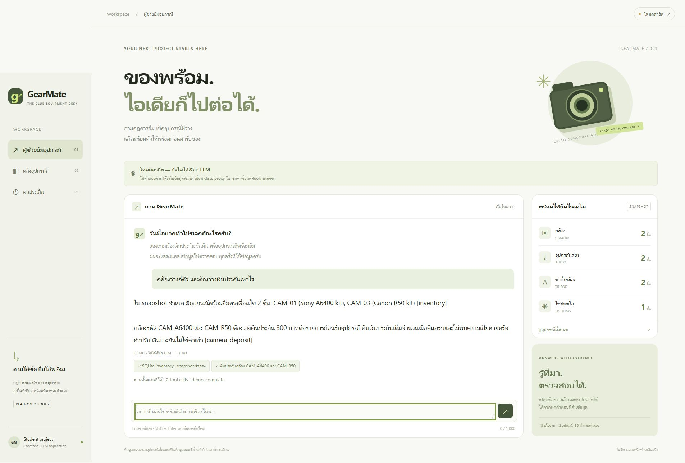
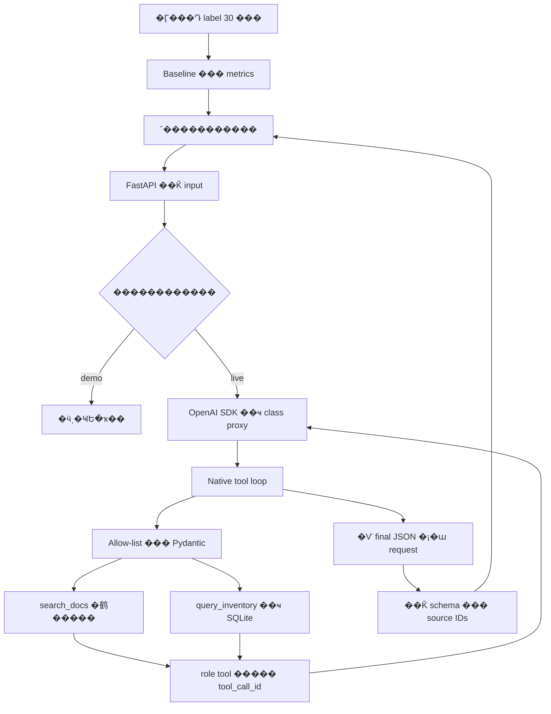

# GearMate � ����������ػ�ó����

�ͻ����������Ѻ�鹡��������ػ�ó���е�Ǩ��¡����ҧ�ҡ SQLite �� agent ���͡ tool �ͧ ������ʴ�������ҧ�ԧ��мš�����¡ tool ����Ǩ�ͺ

**ʶҹлѨ�غѹ:** ����� class proxy ���� `gemma-4-E4B-it` ��з��ͺ��ԧ���������� 25 ���Ҥ� 2569 ���� �ռ� smoke test 3 ʶҹ��ó�� [`results/live-smoke.json`](results/live-smoke.json) ��ǹ retrieval evaluation 30 ����繡���Ѵ�ա�ش˹�� ������ṹ�����١��ͧ�ͧ�ӵͺ LLM

**����͹�Ź�:** [GearMate](https://gearmate.onrender.com)

[](https://render.com/deploy?repo=https://github.com/Chayapon8251/llm_lastwork)



## �ͻ��������

�Ӷ�����ҧ **����ͧ��ҧ����� ��е�ͧ�ҧ�Թ��Сѹ����Ô** ��ͧ���駨ӹǹ�ҡ���ҧ������͹�㹤����� GearMate �֧���ͧ tool:

- `search_docs`: �鹹�º�¡����� �������ͤ������ source ID
- `query_inventory`: ��ҹ SQL snapshot ���µ�ǡ�ͧ����Ǩ�ͺ���� ����Ѻ raw SQL �ҡ����

�����ŷ������繪�������Է�����ҧ��������Ѻ�ç�ҹ: 18 ��º����/�ѧ�������ػ�ó� 12 ��� ��������������Է����¨�ԧ ����� corpus �ͧ�ͻ������ҧ �������ա�èͧ �����Թ ����ź�����Ũ�ԧ

## ��觷�跴�ͺ�Ѻ���Ũ�ԧ����

| �Ӷ�� | ��觷���Ǩ�� |
|---|---|
| ���ʴդ�Ѻ | ���ŵͺ��������¡ tool |
| ���ͧ��ҧ����� ����Թ��Сѹ����� | �� SQL ��Ф鹤����� �ͺ 2 ���ͧ ��Сѹ 300 �ҷ�����¡�� ��ҧ inventory ��� camera_deposit |
| ���ù��������� | ���Ţ� category=drone ��� validator ����ʸ ���ǵͺ�������բ��������Ǵ����ͧ�Ѻ |

�ó��ù�ʴ���û�ͧ�ѹ arguments �͡ schema ������ä����Ǿ���Ҩӹǹ�ù���ٹ�� �ŷ������� smoke test �ͧ����������������鹷ҧ tool �ѧ������ҧ accuracy ���� faithfulness �����

## �ѹ������ͧ

�� Python 3.11 ���� ����ͧ��跴�ͺ�� Python 3.12

```powershell
git clone https://github.com/Chayapon8251/llm_lastwork.git
cd llm_lastwork
py -m venv .venv
.\.venv\Scripts\python.exe -m pip install -r requirements.lock.txt
.\.venv\Scripts\python.exe -m scripts.evaluate
.\.venv\Scripts\python.exe -m uvicorn app.main:app --host 127.0.0.1 --port 8000
```

�Դ http://127.0.0.1:8000 ��д� REST API schema ��� http://127.0.0.1:8000/docs �ҡ�µԴ��������� `run.ps1` �� ��ǹ Linux/macOS �� `python3 -m venv .venv` ��� `.venv/bin/python` ᷹ path �ͧ Python

### ��駤�� class proxy

�Ѵ�͡ `.env.example` �� `.env` ੾��������ѧ�������� `.env` ���ǵ�駤�Ҩҡ����͹:

```dotenv
OPENAI_API_KEY=your-class-proxy-key
OPENAI_BASE_URL=https://llm.nat-d.uk/v1
OPENAI_MODEL=gemma-4-E4B-it
GEARMATE_MODE=live
```

SDK �� `from openai import OpenAI; OpenAI()` ��ҹ��Ҩҡ environment ��Ф����ŵ��⨷�� **������ `.env` ���� API key ��� Git** browser ����� endpoint ��ҹ key ����� server ������ѧ�� `.env`

- `auto`: �� live ������շ�� key ��� base URL �ԩй���������ҸԵ���Դ���ªѴਹ
- `live`: ��ͧ�դ�Ҥú ��� proxy ���������� error �����Ѻ仵ͺ�ҡ����º �
- `demo`: ������͡ tool ��Фӵͺ�Ҩҡ�� ����� LLM
- ���� configured ���¶֧�դ�Ҥú ������õ�Ǩ key �Ѻ proxy ��ͧ�ͧ�Ӷ�������ѹ `python -m scripts.smoke_live`

## Deploy �ͻ����� Render

�� Python/FastAPI ������ frontend ��� backend � Web Service ���� ��������ѻ��Ŵ HTML ���ҧ���� �������ͧ�Դ����ͧ��ǹ��Ƿ�����

1. �Դ���� Deploy to Render ��ҹ�� �������ҧ Blueprint �ҡ repo ���
2. ��Ǩ����� Free instance ��� `render.yaml` ������հҹ������Ẻ�����Թ����
3. ��� `OPENAI_API_KEY` ੾��� environment �ͧ Render ��ͧ������� `sync: false` �֧�������� YAML ���� Git
4. �� build ��� health check `/healthz` ��ҹ ���Ƿ��ͺ�Ӷ����ԧ�� URL `.onrender.com` ��� Render ���
5. ������׹�ѹ���� ��� URL ������ǹ����͹�Ź�ͧ README ������� Q3 ��

Free service �Ҩ�ѡ���������� request ����ҳ 15 �ҷ� ��С���Դ���駶Ѵ��Ҩ�ͻ���ҳ˹�觹ҷ� �����Ţͧ�����Ŵ�ҡ JSON ��� commit ���������ҧ SQLite snapshot ������ �֧����ͧ�� persistent disk

��� deploy �Դ `GEARMATE_PUBLIC_DEMO=true`: �ӡѴ `/api/chat` ��� 6 requests/�ҷյ�� client, 40 requests/���������� ��� 120 requests/�ѹ��� ������մ�ӡѴ��Ҵ body 64 KiB ��� 2 requests �������żž�����ѹ Budget �����˹��¤����Ӣͧ process ������� reset ����� restart ������к� quota ��������Ѻ production ���ФӶ���ѧ���¡ LLM �����¤��駵�� agent loop

���ͺ����͹�Ź�Ѻ class proxy ��ԧ��������� 27 ���Ҥ� 2569: �Ӷ������ͧ���ͧ���¡��� `query_inventory` ��� `search_docs` �ͺ 2 ���ͧ����Թ��Сѹ 300 �ҷ�����¡�� �����������ҧ�ԧ �ټ�� [`results/deployment-smoke.json`](results/deployment-smoke.json) ��Т�鹵͹ deploy � [`docs/deploy-th.md`](docs/deploy-th.md)

## ʶһѵ¡���



��ش��������ŵͺ������� tool call ���ͤú 5 model turns / 8 tool calls ����ʸ call ������ ����觼ŵͺ�ء `tool_call_id` ����ó� parallel calls

| �������������ö��Ԫ� | ��ǹ����� |
|---|---|
| Structured output ��� validation | `app/schemas.py` �Ѻ final JSON renderer |
| Evaluation ���⨷��ѧ�Ѻ | �ش 30 ������ `scripts/evaluate.py` |
| Agent loop Ẻ agentic | native function calling ����� stop condition |
| SQL Ẻ advanced/agentic | SELECT �ҡ template ��� bound values �� query-only connection |
| REST ��� UI | FastAPI �����˹��᪵ ��ѧ�ػ�ó� ��мŻ����Թ |
| Retrieval ��� citation | TF-IDF Ẻ lexical ����� neural semantic embeddings |

## �����Թ retrieval

```powershell
.\.venv\Scripts\python.exe -m scripts.evaluate
.\.venv\Scripts\python.exe -m pytest -q
```

| �Ը� | k | Recall@k | Precision@k | MRR ���¡�÷��׹ | �ú�ء���� |
|---|---:|---:|---:|---:|---:|
| Vector top-1 baseline | 1 | 0.8000 | 1.0000 | 1.0000 | 0.6000 |
| Vector top-3 ���͡�� | 3 | 0.9833 | 0.4556 | 1.0000 | 0.9667 |
| BM25 top-3 | 3 | 0.9667 | 0.4444 | 0.9833 | 0.9333 |
| Hybrid RRF top-3 | 3 | 0.9833 | 0.4556 | 1.0000 | 0.9667 |

���͡ vector top-3 ���� recall �����ҡ top-1 ����ҳ 18.33 percentage points �������º��º�������¹�ӹǹ context ���� ��ͧ�����ҧ��ҼŴբ�鹷������Ҩҡ hybrid �������º��� k=3 ��ҡѹ hybrid ���͡Ѻ vector �֧�ѧ������͡�� default

�ش�Ӷ���� 18 single-source ��� 12 multi-source ���ҧ�Ǻ���Ѻ corpus ���� AI ���� �ѧ����� independent labels ����դ�������§�ҡ�ӷ��ç�ѹ�ҡ�Թ� �Ź���� retrieval metrics ������ṹ�ӵͺ LLM ����¢����� hashes ����� `results/retrieval.json`

Failure ��������: t27 ������ͧͺ���� ����ش�Թ��Сѹ���ͧ����Թ��Сѹ��������� �ա�Ӷ���͡�ش��� ���������ѹ� ��� retriever �ç � �Ҩ���׹ duration � top-3 �֧����ö����Ш���� ���������������Ԕ �Ф���

## �͡�����С���觧ҹ

- **��Ѻ��ѡ������ ��䢵����:** [`docs/report-th.docx`](docs/report-th.docx)
- **��ͤ�������Ѻ�Ѵ�͡� Google Docs:** [`docs/report-th.md`](docs/report-th.md)
- **PDF �����ѧ��ɩ�Ѻ���:** [`docs/report.pdf`](docs/report.pdf) ����ҧ��͹�׹�ѹ proxy ��ԧ ����ҹ��Сͺ �����ʶҹ�����ش
- ������͸Ժ���� [`docs/walkthrough-th.md`](docs/walkthrough-th.md)
- Proposal [`docs/proposal.md`](docs/proposal.md)
- ������ҧ���͡ [`docs/demo-script-th.md`](docs/demo-script-th.md)
- ʶҹС�͹�� [`docs/submission-checklist.md`](docs/submission-checklist.md)

⨷���к������ **�AI tools freely�** �� ���ͧ�բ�������Ъش�����Թ�ͧ���ͧ ���͸Ժ�� design choice �Ѻ����Ţ�� ��§ҹ����кء���� AI �����ԧ ����觤�õ�Ǩ labels ��л�Ѻ��͸Ժ�����ç�������� �������¹�ŷ��ͧ���ٴա��ҷ���ѹ��

Q1 �� public GitHub repo, Q2 ����§ҹ PDF 4�8 ˹���� export �ҡ��Ѻ����Ǩ����, Q3 ���͡ **��纷�� deploy ��зӧҹ��ԧ ���ͤ�Ի 3�6 �ҷ�** ���ҧ����ҧ˹�� �ѧ��ͧ�����͸Ժ�¡ó��������Т�ͨӡѴ����Ѻ��� demo �Ѻ����͹

## ������ҧ�ԧ

- Lectures 8�14 �ͧ����Ԫ� ����Ѻ metrics, RRF, tool round-trip ��� SQL guardrails
- [OpenAI function calling](https://developers.openai.com/api/docs/guides/function-calling)
- [Render FastAPI deployment](https://render.com/docs/deploy-fastapi) ��� [��ͨӡѴ Free service](https://render.com/docs/free)

����� corpus ���ҧ������� AI assistance ����� fork ��������¹˹�ҵ� reference app ���繧ҹ�ͧ���ͧ
