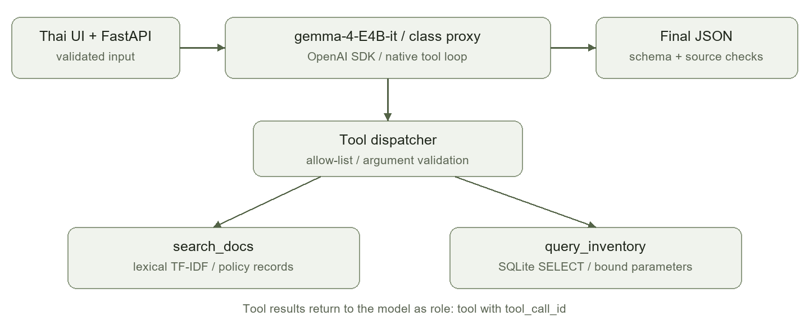

# รายงานโครงงาน GearMate

ผู้ช่วยค้นกฎการยืมและตรวจอุปกรณ์ชมรม

ผู้พัฒนา Chayapon8251
Repository https://github.com/Chayapon8251/llm_lastwork
วันที่ทดสอบ 25 ตุลาคม 2569

### 1 ปัญหาและผู้ใช้งาน

ผมเลือกทำ GearMate สำหรับนักศึกษาที่ต้องการยืมอุปกรณ์ชมรม เพราะคำถามหนึ่งมักต้องใช้ข้อมูลมากกว่าหนึ่งแบบ เช่น “กล้องว่างกี่ตัว และต้องวางเงินประกันเท่าไร” ส่วนแรกเป็นสถานะในตาราง ส่วนหลังเป็นเงื่อนไขในคู่มือ ถ้าให้โมเดลตอบจากความจำอย่างเดียวก็อาจได้จำนวนหรือกฎที่ไม่ตรงข้อมูล

ระบบจึงให้ผู้ใช้ถามผ่านหน้าเว็บภาษาไทย แล้วให้ agent เลือกค้นคู่มือด้วย search_docs หรืออ่านรายการอุปกรณ์ด้วย query_inventory ผลลัพธ์แสดงคำตอบ แหล่งอ้างอิง และขั้นตอนการเรียก tool เพื่อให้ตรวจสอบได้ว่าใช้ข้อมูลอะไร

### 2 ขอบเขตข้อมูลและสิ่งที่ทำได้

ข้อมูลเป็นชมรมสมมติที่สร้างขึ้นสำหรับโครงงานนี้ ประกอบด้วยนโยบาย 18 หัวข้อและอุปกรณ์ 12 ชิ้น ไม่ใช่นโยบายหรือสถานะจริงของมหาวิทยาลัย และไม่ได้ใช้ corpus ของแอปตัวอย่างรายวิชา ระบบอ่านข้อมูลอย่างเดียว ไม่มีการจอง ชำระเงิน หรือแก้ไขรายการยืม

วันที่ทดสอบสามารถเรียก class proxy ด้วยโมเดล gemma-4-E4B-it ได้จริงแล้ว โดยลองคำทักทาย คำถามที่ต้องใช้ทั้ง SQL และคู่มือ และคำถามเรื่องโดรนที่ระบบไม่รองรับ ส่วนการประเมิน retrieval ใช้ชุดคำถามติด label 30 ข้อแยกต่างหาก

### 3 ข้อสรุปของการออกแบบ

ผมเลือก vector top-3 เป็นค่าเริ่มต้น เพราะ recall เพิ่มจาก baseline top-1 ส่วน hybrid ให้ผลเท่ากันเมื่อเปรียบเทียบที่ k=3 จึงยังไม่มีเหตุผลจากชุดทดลองนี้ให้เพิ่มความซับซ้อนเป็นค่าเริ่มต้น ตัวค้นปัจจุบันใช้ TF-IDF แบบ lexical ไม่ใช่ neural semantic embeddings

## สถาปัตยกรรมและเทคนิคที่ใช้

### 4 โครงสร้างระบบ

ภาพที่ 1 หน้าเว็บส่งคำถามเข้า FastAPI จากนั้น agent ขอใช้ tool ผ่าน class proxy โค้ดตรวจชื่อและ arguments ก่อนรัน แล้วส่งผลกลับให้โมเดล คำตอบขั้นสุดท้ายถูกตรวจรูปแบบและแหล่งอ้างอิงอีกชั้น

### 5 วงรอบของ agent

เริ่มจากรับคำถามและบริบทที่จำกัดความยาว ส่งให้ OpenAI() พร้อม tool schemas โดยใช้ model="gemma-4-E4B-it" และ temperature=0 หากโมเดลส่ง tool_calls โค้ดจะเก็บ assistant message แปลง arguments จาก JSON ตรวจด้วย Pydantic แล้วรัน tool ที่อยู่ใน allow-list

ผลแต่ละ call ถูกเพิ่มเป็น role: "tool" พร้อม tool_call_id ที่ตรงกัน รวมถึงเมื่อมีหลาย call ในรอบเดียว โมเดลจึงอ่านผลแล้วเลือกว่าจะค้นต่อหรือสรุปคำตอบ หยุดตามปกติเมื่อไม่มี tool_calls และมี max_steps=5 กับงบรวม 8 tool calls เป็นตัวหยุดสำรอง รวมทั้งปฏิเสธการเรียกเดิมซ้ำ

### 6 ความเชื่อมโยงกับเนื้อหารายวิชา

โครงงานใช้ structured output พร้อม schema validation, evaluation บนชุดติด label, agent loop ที่มี function calling และ stop condition, SQL แบบอ่านอย่างเดียว และ FastAPI REST/UI จึงมีทั้ง evaluation และความสามารถแบบ agentic ตามขอบเขตงาน

ขั้นเลือก tool ใช้ native tool calling ส่วนขั้นจัดคำตอบเป็น JSON ใช้การเรียกอีกครั้งที่ไม่มี tools เพื่อไม่ให้คำสั่ง “ตอบเฉพาะ JSON” รบกวนการเลือก tool คำตอบถูกตรวจให้มี answer, source_ids และ supported และ source_ids ต้องมาจาก tool ที่ถูกเรียกจริง

## ข้อมูล การค้น และขอบเขตความปลอดภัย

### 7 การเตรียม corpus และ index

แต่ละหัวข้อนโยบายเป็นหนึ่ง chunk เพื่อไม่ตัดเงื่อนไขกลางเรื่อง เช่น การต่อเวลาต้องแจ้งก่อน 24 ชั่วโมงและได้รับอนุมัติ ข้อมูลมี ID คงที่ ข้อความไทย และคำแปลอังกฤษ เพื่อใช้อ้างอิงและทดสอบทั้งสองภาษา ไฟล์ดิบอยู่ใน data/policies.json ส่วน snapshot อุปกรณ์อยู่ใน data/inventory.json

ตัว vector ใช้ character trigrams แปลงเป็น TF-IDF แล้วคำนวณ cosine similarity จึงไม่ต้องใช้บริการ embedding ภายนอก ส่วน BM25 ใช้ English tokens ร่วมกับ Thai bigrams ทั้งสอง index สร้างในหน่วยความจำจากข้อมูลใน repo จุดอ่อนคือยังอาศัยคำหรือตัวอักษรที่ตรงกัน และอาจพลาดคำถามที่ใช้คำต่างจากเอกสารมาก

### 8 วิธีที่นำมาเปรียบเทียบ

ทดลอง vector top-1 เป็น baseline แบบง่าย จากนั้น vector top-3 เพื่อดูผลของจำนวน context, BM25 top-3 และ hybrid top-3 ที่รวมอันดับด้วย RRF โดย score(doc)=sum(1/(60+rank)) เริ่ม rank ที่ 1 และนำ top-10 ของแต่ละตัวค้นมารวมกัน ไม่เฉลี่ยคะแนน BM25 กับ cosine เพราะอยู่คนละสเกล

ใช้ cosine floor 0.04 เหมือนกันทุกวิธี ค่านี้เป็น heuristic ระหว่างพัฒนา ไม่ใช่คะแนนความมั่นใจที่ปรับเทียบแล้ว ยังไม่มีการทดสอบ negative set ขนาดใหญ่ และไม่ควรสรุปว่าผ่าน threshold แล้วคำตอบจะถูกเสมอ เวอร์ชันนี้ยังไม่มี cross-encoder หรือ LLM reranker

### 9 การควบคุม SQL และข้อมูลจาก tool

query_inventory รับเฉพาะ category, code และ status โค้ดเป็นผู้สร้าง SELECT จาก template ใช้ ? bind values และเปิด SQLite เป็น query_only พร้อม LIMIT 30 จึงไม่มีช่องให้โมเดลส่ง SQL อิสระหรือเปลี่ยนตาราง ตัว validator ปฏิเสธชื่อหมวดและ arguments นอก schema

ข้อความจาก history และผล tool ถือเป็นข้อมูลที่ไม่เชื่อถือ ไม่ใช่คำสั่งให้ข้ามข้อจำกัด ระบบไม่มี tool สำหรับจอง ตัดเงิน ลบข้อมูล หรือรันโค้ดทั่วไป ส่วนการตรวจ citation ยืนยันได้เพียงว่า ID เคยถูกค้นจริง ยังต้องตรวจว่าข้อความในคำตอบสอดคล้องกับหลักฐานด้วย

## การประเมิน retrieval และผลเปรียบเทียบ

### 10 ชุดข้อมูลและวิธีวัด

ชุด eval/test.json มี 30 คำถาม แบ่งเป็นคำถามที่ต้องใช้แหล่งเดียว 18 ข้อและสองแหล่ง 12 ข้อ มีคำถามไทย รหัสอุปกรณ์ตรงตัว และคำถามอังกฤษหลายประเด็น มีชุด dev อีก 6 ข้อและสถานการณ์ที่ข้อมูลไม่รองรับอีก 6 ข้อแยกไว้ ไม่รวมกรณีไม่มี relevant เข้าไปทำให้ค่า recall ดูดีขึ้น

labels สร้างควบคู่กับ corpus โดยใช้ AI ช่วย ยังไม่ได้ให้ผู้ประเมินอิสระตรวจ จึงมีความเสี่ยงที่คำในคำถามตรงกับเอกสารมากเกินไป และหลังจากเปิดดูผลแล้วควรถือชุดนี้เป็น development benchmark ก่อนอ้างผลทั่วไปต้องสร้าง held-out set ใหม่

Recall@k วัดสัดส่วน relevant IDs ที่อยู่ในผล k อันดับแรก Precision@k หารด้วย k ส่วน MRR เฉลี่ย 1/rank ของ relevant ตัวแรกในรายการที่คืนมา ถ้าไม่พบให้เป็น 0 และวัดสัดส่วนคำถามที่ค้นครบทุกแหล่งเพิ่มด้วย ทุก metric เฉลี่ยรายคำถามและระบุ k ของแต่ละระบบ

| วิธีค้นข้อมูล | k | Recall | Precision | MRR | ครบทุกแหล่ง |
| --- | --- | --- | --- | --- | --- |
| Vector top 1 baseline | 1 | 0.8000 | 1.0000 | 1.0000 | 0.6000 |
| Vector top 3 เลือกใช้ | 3 | 0.9833 | 0.4556 | 1.0000 | 0.9667 |
| BM25 top 3 | 3 | 0.9667 | 0.4444 | 0.9833 | 0.9333 |
| Hybrid RRF top 3 | 3 | 0.9833 | 0.4556 | 1.0000 | 0.9667 |

ตารางที่ 1 ผลที่รันซ้ำได้จาก python -m scripts.evaluate โดยไม่มีการเรียก LLM

### 11 การตีความและการเลือกค่าเริ่มต้น

จาก top-1 เป็น top-3 recall เพิ่มจาก 0.8000 เป็น 0.9833 หรือประมาณ 18.33 percentage points และค้นครบทุกแหล่งเพิ่มจาก 60.00% เป็น 96.67% แต่ precision ลดเพราะมีบริบทที่ไม่เกี่ยวข้องเพิ่มขึ้น ความดีขึ้นนี้ส่วนหนึ่งมาจากงบจำนวน chunk ไม่ใช่หลักฐานว่าอัลกอริทึม hybrid ดีกว่า

เมื่อเทียบที่ k=3 เท่ากัน hybrid เสมอกับ vector จึงเลือก vector top-3 ส่วน MRR=1.0 แปลว่า relevant แรกอยู่ลำดับแรกในชุดนี้ ไม่ได้หมายความว่าหลักฐานครบหรือคำตอบ LLM ถูกทุกข้อ ไฟล์ results/retrieval.json เก็บอันดับรายข้อ failure และ hash ของข้อมูลกับโค้ดเพื่อทำซ้ำ

## ผลเรียกโมเดลจริงและกรณีที่ยังผิดพลาด

### 12 การทดสอบ class proxy

หลังตั้ง environment ใน .env ได้ทดสอบผ่าน OpenAI SDK กับ class proxy จริงโดยใช้ gemma-4-E4B-it สามสถานการณ์ต่อไปนี้ เป็น smoke test เพื่อตรวจการเชื่อมต่อและเส้นทาง tool ไม่ใช่การประเมิน faithfulness หรือ accuracy ที่ครอบคลุมผู้ใช้จริง

| คำถาม | สิ่งที่เกิดขึ้น | เวลารวมโดยประมาณ |
| --- | --- | --- |
| สวัสดีครับ | ตอบทักทายโดยไม่เรียก tool | 2.93 วินาที |
| กล้องว่างกี่ตัว และเงินประกันเท่าไร | ใช้ query_inventory และ search_docs ตอบ 2 กล้อง ประกัน 300 บาทต่อรายการ อ้าง inventory และ camera_deposit | 2.04 วินาที |
| มีโดรนให้ยืมไหม | ขอ query_inventory ด้วย category=drone ถูก validator ปฏิเสธ แล้วตอบว่าไม่มีข้อมูลในหมวดที่รองรับ | 1.17 วินาที |

เวลานี้เป็นผลรอบเดียวต่อสถานการณ์ รวมการจัดคำตอบเป็น JSON ไม่ใช่ค่าเฉลี่ย latency และอาจเปลี่ยนเมื่อรันใหม่ ผลโดรนแสดงว่าระบบป้องกัน arguments นอก schema ได้ แต่ไม่ได้พิสูจน์ว่ามีการค้นฐานข้อมูลแล้วพบโดรนเป็นศูนย์ จึงควรใช้ถ้อยคำว่า “ระบบไม่รองรับหมวดนี้”

### 13 ข้อผิดพลาดในการค้นที่ต้องรายงาน

ข้อ t27 ถามทั้งเงินประกันกล้องและการอบรม ต้องการ camera_deposit กับ training แต่ vector top-3 คืน training, lighting_deposit และ audio_deposit จึงได้ recall 0.5 แม้ MRR ยังเป็น 1 เพราะ relevant ตัวแรกอยู่บนสุด คำเรื่องเงินประกันหลายประเภททำให้ตัวค้นสับสน

อีกกรณีที่ตรวจหลังพัฒนาคือคำถามสั้น “ยืมได้กี่วัน” ตัวค้นตรง ๆ ได้ extension, membership และ weekend_return แทน duration แต่คำว่า “ระยะเวลายืมปกติ” ค้นเจอ กรณีนี้เป็นข้อจำกัดของ retriever ไม่ใช่ผลทดลองว่า live agent ล้มเหลวเสมอ เพราะโมเดลอาจปรับ query ก่อนค้น

การทดสอบอัตโนมัติ 39 tests ครอบคลุม validators, SQL query-only, bound parameters, API และ protocol ของ agent ด้วย stubbed responses ต้องแยกผลนี้ออกจาก smoke test ที่เรียกโมเดลจริง และยังต้องมีคนตรวจว่าคำตอบอ้างหลักฐานได้ตรงหรือไม่

## ข้อจำกัด สิ่งที่ทำต่อ และแหล่งอ้างอิง

### 14 ข้อจำกัดของผลทดลอง

ข้อมูลและ snapshot มีขนาดเล็กและเป็นข้อมูลจำลอง ไม่มีการเชื่อมระบบชมรมจริง ชุดคำถามสร้างจาก corpus เดียวกันและยังไม่มี independent labels จึงไม่ควรใช้ recall สูงในชุดนี้ไปอ้างว่าตอบคำถามจริงได้แม่นยำเท่ากัน ตัว TF-IDF เป็น lexical representation และ cosine floor ยังไม่ผ่านการปรับเทียบกับกรณีนอกโดเมนจำนวนมาก

ผลโมเดลจริงที่บันทึกมีเพียงสามสถานการณ์ แสดงว่าเชื่อม proxy และเรียก tool ได้ ไม่พอจะสรุป accuracy, robustness หรือ faithfulness โดยรวม การมี citation อยู่ในผล tool ก็ไม่ได้รับประกันว่าทุกประโยคของคำตอบถูกต้อง

### 15 สิ่งที่ควรทำต่อก่อนส่งงาน

ผมควรตรวจ corpus กับ labels เองและให้คนอีกคนเขียนคำถามใหม่ เพิ่มการตรวจคำตอบ LLM เป็นรายข้อว่าถูกครบ มีข้ออ้างที่ไม่มีหลักฐาน หรือควรปฏิเสธ จากนั้นทดลอง multilingual embeddings, query refinement หรือ reranker โดยคุมจำนวน chunk เท่ากัน และเก็บเฉพาะการเปลี่ยนแปลงที่คุ้มกับ latency และค่าใช้จ่าย

ก่อน demo ต้องอ่านและอธิบายเส้นทาง tool, เหตุผลที่เลือก top-3 และความต่างระหว่าง recall กับ MRR ได้ พร้อมลองคำถามใหม่ที่ไม่ได้เตรียมไว้ ส่วนคลิปสาธิต 3-6 นาทียังไม่ได้บันทึก และจะแสดงทั้งกรณีสำเร็จกับข้อจำกัดตามโจทย์ในขั้นต่อไป

### 16 การใช้ AI และสิ่งที่ผู้ส่งต้องรับผิดชอบ

โค้ด corpus และร่างเอกสารนี้พัฒนาด้วยความช่วยเหลือจาก AI ตามที่โจทย์อนุญาต การแก้สำนวนควรทำเพื่อให้ตรงความเข้าใจของผู้ส่ง ไม่ควรเปลี่ยนผลทดลองหรือเขียนอ้างว่าทดสอบกับผู้ใช้จริงทั้งที่ยังไม่ได้ทำ ผู้ส่งยังต้องตรวจความถูกต้องและอธิบายการออกแบบด้วยตนเอง

### 17 แหล่งอ้างอิงและไฟล์สำหรับทำซ้ำ

แนวคิด metrics และ RRF มาจาก Lecture 8 ส่วน tool calling, bounded agent loop และ SQL guardrails มาจาก Lectures 10-14 การต่อ native calls อ้างอิง OpenAI Function calling documentation ที่ https://developers.openai.com/api/docs/guides/function-calling

Repository https://github.com/Chayapon8251/llm_lastwork
รัน retrieval evaluation ด้วย python -m scripts.evaluate
รัน tests ด้วย python -m pytest -q
ผล retrieval อยู่ที่ results/retrieval.json และผล smoke test ที่ตัด credentials ออกอยู่ที่ results/live-smoke.json
